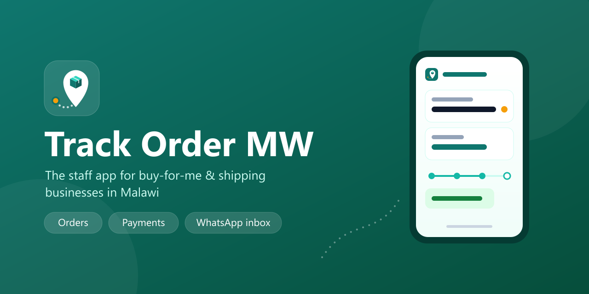

<p align="center">
  
</p>

<p align="center">
  <a href="https://github.com/SimeonMataka/track-order-mw_app-releases/releases/latest"></a>
  <a href="https://github.com/SimeonMataka/track-order-mw_app-releases/releases"></a>
  
</p>

<h3 align="center">
  <a href="https://github.com/SimeonMataka/track-order-mw_app-releases/releases/latest">Download the latest version for Android</a>
</h3>

---

**Track Order MW** helps businesses that buy goods abroad for their customers (China, Dubai, South
Africa …) and ship them to Malawi. Staff use this app on their phones to keep every order, payment
and customer conversation in one place, while customers follow their orders on a tracking link.

This repository only holds the **installable app files** (Android APKs) and their release notes.
There is no source code here.

## What you can do with the app

| | |
| --- | --- |
| **Orders** | Log requests with photos straight from the camera, add prices, update the status, flag delays, share the tracking link |
| **Payments** | Record deposits and payments in seconds – the customer gets a receipt automatically |
| **WhatsApp inbox** | Read and answer customers' WhatsApp and tracking-page messages, with their order right beside the chat |
| **Notifications** | New customer messages, quotation answers and problems arrive instantly – reply straight from the notification |
| **Customers** | Find any customer, see what they owe, send a balance reminder on WhatsApp |
| **Secure** | Your own business account, optional fingerprint / Face ID lock, sign-in stored in the phone's secure keystore |

## Install on your Android phone

<table>
  <tr>
    <td width="68%">

1. On your phone, open the [**latest release**](https://github.com/SimeonMataka/track-order-mw_app-releases/releases/latest)
   – or scan the QR code with your camera.
2. Under **Assets**, tap the file that ends in **`.apk`** (for example `track-order-mw-1.0.0.apk`).
3. Open the downloaded file and tap **Install**. If Android asks, allow installing apps from your
   browser – only for this download.
4. Open **Track Order MW** and sign in with the email and password of your business account.

    </td>
    <td width="32%" align="center">
      <br>
      <sub>Scan to download</sub>
    </td>
  </tr>
</table>

> **No account yet?** Accounts are created by your business owner or manager in the web app
> (Settings → Team). Ask them to invite you.

## Updates

You rarely need to come back here:

- **Small improvements** download by themselves in the background and apply the next time you open
  the app (or tap **Restart now** when the app offers it).
- **New versions** are announced inside the app: a banner on the home screen, a notification, and
  **More → App updates** with what's new and a download button. Install the new file over the old
  one – you stay signed in.
- Sometimes a version is **required** (for example after a security fix). The app then shows
  **Update required** with a download button until you install it.

## Check the download (optional)

Every release includes a `.sha256` file with the checksum of the app. Compare it with your download:

```bash
# Linux / macOS
sha256sum track-order-mw-1.0.0.apk
```

```powershell
# Windows
certutil -hashfile track-order-mw-1.0.0.apk SHA256
```

The same checksum is shown on the **Get the app** page inside the web app.

## Versions and channels

| Release type | Who it is for |
| --- | --- |
| **Latest release** | Everyone – stable, tested versions |
| **Pre-release** | Testers – early versions before they go to everyone |

Version numbers follow `MAJOR.MINOR.PATCH` (for example `1.2.0`). See all
[releases and their notes](https://github.com/SimeonMataka/track-order-mw_app-releases/releases).

## Privacy & security

- The app only talks to the Track Order MW server of the business you sign in to. There are no ads
  and no tracking or analytics tools.
- Your sign-in is kept in the phone's secure keystore; signing out removes it, and your business
  can sign a lost phone out remotely.
- Notifications show customer names and messages. If others use your phone, choose **Hide
  sensitive content** for Track Order MW in your phone's notification settings.

## Need help?

Ask your business owner or manager first – they manage your account. For problems with the app
itself, contact the Track Order MW team through the **Help centre** in the web app.

<details>
<summary><b>For maintainers: how releases get here</b></summary>

Releases are produced automatically from the private source repository:

1. Bump the app version and run the GitHub Action **Mobile release (APK → GitHub release)**. It
   builds the APK on Expo EAS and publishes it here as `v<version>` with its `.sha256` checksum.
2. In the web app: **Platform admin → Mobile app → Import from GitHub**, review "What's new", then
   **Publish**. Users are notified and the app shows the new version.

Small JavaScript-only fixes are shipped as over-the-air updates and never appear here.

</details>

---

<p align="center"><sub>© Track Order MW · All rights reserved. The app files in this repository may be installed by staff of businesses using Track Order MW.</sub></p>
